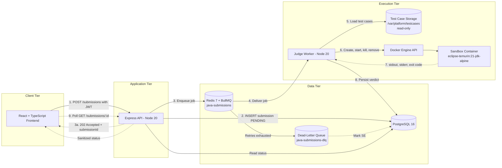
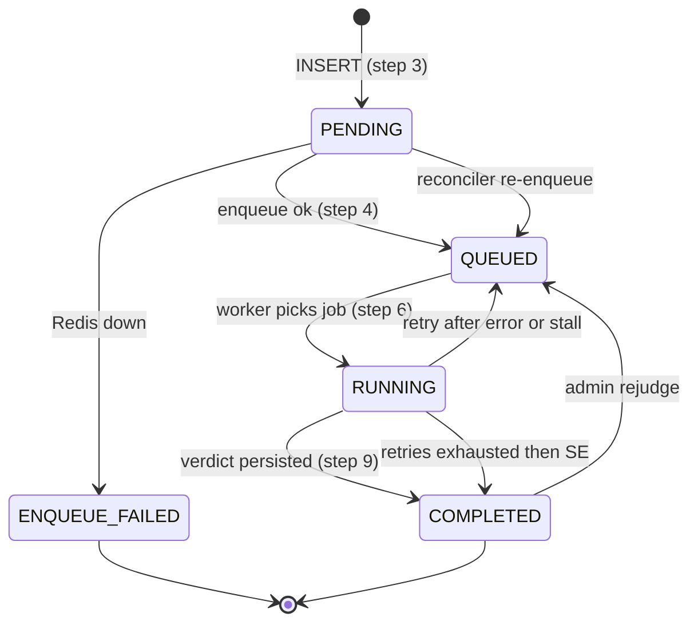

# 🏗️ System Architecture — Java Judge Platform (V1 MVP)

| | |
|---|---|
| **Document status** | Living document — V1 MVP baseline |
| **Audience** | Backend, frontend, judge-worker and DevOps contributors |
| **Scope** | Student submissions, admin management, contest execution, isolated Java 21 code execution |
| **Hosting model** | 100% local / free — runs on a standard developer machine with Docker, no cloud dependency |

---

## 📑 Table of Contents

1. [Scope, Constraints & Non-Goals](#1-scope-constraints--non-goals)
2. [Tech Stack](#2-tech-stack)
3. [System Architecture Diagram](#3-system-architecture-diagram)
4. [Queue, Retry & Exception Handling](#4-queue-retry--exception-handling)
5. [Multi-Layer Docker Sandbox Security](#5-multi-layer-docker-sandbox-security)
6. [Verdict Matrix & Exception Classification](#6-verdict-matrix--exception-classification)
7. [Hidden Test Case Protection & API Security](#7-hidden-test-case-protection--api-security)
8. [Feature Boundaries: Run Code vs Submit Solution](#8-feature-boundaries-run-code-vs-submit-solution)
9. [Step-by-Step Submission Execution Lifecycle](#9-step-by-step-submission-execution-lifecycle)
10. [Data Model Summary](#10-data-model-summary)
11. [Configuration Reference](#11-configuration-reference)
12. [Known Limitations & V2 Roadmap](#12-known-limitations--v2-roadmap)

---

## 1. Scope, Constraints & Non-Goals

### ✅ In scope (V1)

- **Language:** Java 21 (OpenJDK) only.
- **Personas:** Students (submit, view own results), Admins (manage problems, test cases, contests, rejudge).
- **Capabilities:** Contest execution, asynchronous judging, isolated code execution, result polling.
- **Hosting:** Everything runs locally (Docker Compose or native processes). No paid or cloud services.

### 🚫 Out of scope (V1)

| Item | Reason / Plan |
|---|---|
| Multi-language support | The sandbox image, compile step and verdict mapping are Java-specific. Planned for V2 via a per-language runner profile. |
| Public live WebSocket leaderboard | V1 uses HTTP polling only. |
| Mobile apps | Responsive web UI only. |
| Cloud deployment, autoscaling workers | V1 targets a single host. |
| Special judges / interactive problems | V1 supports standard stdin/stdout problems with a token-based checker. |

<details>
<summary><b>📌 Design principles (click to expand)</b></summary>

1. **Never trust user code.** All submitted code runs in a locked-down, network-less, resource-capped container.
2. **Never trust the client.** The browser never receives hidden test data, expected output, diffs or execution traces.
3. **Infrastructure failures are not user failures.** A platform fault yields `SE`, never `WA`/`RTE`/`TLE`.
4. **Idempotent judging.** A submission can be delivered more than once (retries, stalled jobs); the final state is always consistent.
5. **PostgreSQL is the source of truth.** Redis holds transient job state only. Losing Redis must never lose a submission.
6. **Fail closed.** If isolation cannot be guaranteed (e.g. Docker unavailable), the job is not executed on the host.

</details>

---

## 2. Tech Stack

| # | Layer | Technology | Version | Responsibility |
|---|---|---|---|---|
| 1 | Frontend | React.js + TypeScript | 18.x | Problem view, editor, submission UI, status polling, admin console |
| 2 | Backend API | Node.js + Express.js | 20.x LTS | AuthN/AuthZ, validation, persistence, enqueueing, result sanitization |
| 3 | Primary DB | PostgreSQL | 16 | ACID storage: Users, Contests, Problems, Submissions, Test case manifests |
| 4 | Queue / Broker | Redis + BullMQ | Redis 7 | Async execution jobs, concurrency limits, retries, dead-letter queue |
| 5 | Judge Worker | Node.js worker process | 20.x LTS | Consumes jobs, loads test cases, drives Docker Engine API, computes verdicts |
| 6 | Sandbox Runtime | Docker Engine API + OpenJDK | `eclipse-temurin:21-jdk-alpine` | Isolated compile and run of untrusted Java code |
| 7 | Test Case Storage | Local FS (default) / MinIO (optional) | — | `/var/platform/testcases/`, mounted **read-only** into the worker; keeps DB lean |

> **Storage abstraction:** the worker reads test cases through a `TestCaseStore` interface (`list()`, `read()`, `checksum()`). V1 ships a `LocalFsTestCaseStore`; a `MinioTestCaseStore` can be swapped in without changing worker logic.

---

## 3. System Architecture Diagram



<details>
<summary><b>🔍 Diagram legend & component responsibilities</b></summary>

| Arrow | Meaning |
|---|---|
| `-->` (solid) | Synchronous or primary data / control flow |
| `-.->` (dotted) | Asynchronous response, polling, or failure-path flow |

| Component | Owns | Must never |
|---|---|---|
| **Frontend** | UI state, polling loop, rendering the result card | Hold secrets or receive hidden test data |
| **API** | Auth, validation, rate limiting, DB writes for submissions, enqueue, DTO sanitization | Execute user code, read the test case directory |
| **PostgreSQL** | Durable state | Store test case bodies |
| **Redis/BullMQ** | Job lifecycle, locks, retries, DLQ | Be treated as durable storage of record |
| **Judge Worker** | Compile/run orchestration, verdict computation, verdict persistence | Run user code on the host; expose test data to the sandbox |
| **Sandbox** | Executing one untrusted JVM process | Access network, host FS (except its own working dir) or test cases |

> **Note on Mermaid syntax:** edge labels use the form `-.->|"label"| Node`. The label belongs **between** the arrow and the target node. Writing `-.->"label"| Node` is a parse error on GitHub.

</details>

---

## 4. Queue, Retry & Exception Handling

### 4.1 Queues

| Queue | Purpose | Producer | Consumer |
|---|---|---|---|
| `java-submissions` | Primary queue. Job names: `judge` (official submission), `run-code` (ephemeral dry run) | API | Judge Worker |
| `java-submissions-dlq` | Dead-letter queue. Holds jobs that exhausted retries or stalled beyond the limit | Judge Worker (`failed` handler) | Admin tooling / manual or scripted replay |

> BullMQ has no native DLQ. The DLQ is implemented as a second queue; the worker's `failed` event handler moves a job there once `attemptsMade >= opts.attempts`, or when BullMQ fails it for being stalled too many times.

<details>
<summary><b>⚙️ BullMQ configuration (click to expand)</b></summary>

```ts
// Queue (producer side)
const submissionQueue = new Queue('java-submissions', {
  connection: redis,
  defaultJobOptions: {
    attempts: 3,                                   // 1 initial run + 2 retries (see note below)
    backoff: { type: 'exponential', delay: 2000 }, // 2s, 4s
    removeOnComplete: { age: 3600, count: 1000 },
    removeOnFail: false,                           // keep for inspection; DLQ copy is created on final failure
  },
});

// Enqueue with idempotent job id (prevents duplicate jobs for the same submission)
await submissionQueue.add('judge', { submissionId }, { jobId: submissionId });

// Worker (consumer side)
const worker = new Worker('java-submissions', processJob, {
  connection: redis,
  concurrency: Number(process.env.JUDGE_CONCURRENCY ?? 2), // keep <= physical cores / cpus-per-container
  lockDuration: 30_000,      // 30s lock; auto-renewed while the worker event loop is alive
  stalledInterval: 30_000,   // how often BullMQ scans for stalled jobs
  maxStalledCount: 3,        // a job may stall at most 3 times before being failed
});

worker.on('failed', async (job, err) => {
  if (!job) return;
  const exhausted = job.attemptsMade >= (job.opts.attempts ?? 1);
  const stalledOut = err.message.includes('stalled more than allowable limit');
  if (exhausted || stalledOut) {
    await dlq.add('dead', { ...job.data, reason: err.message, failedAt: Date.now() });
    await markSubmissionSystemError(job.data.submissionId, 'RETRIES_EXHAUSTED');
  }
});
```

**Retry semantics.** `attempts: 3` counts total executions *after a thrown error*. Separately, `maxStalledCount: 3` bounds how many times a job may be re-delivered after a worker crash (lock expiry). Together they guarantee a bounded number of executions per submission.

</details>

### 4.2 Failure-Mode Matrix

| # | Failure scenario | Detection | System behaviour | Final user-visible outcome |
|---|---|---|---|---|
| F1 | **Redis down at enqueue time** | `queue.add()` throws / connection refused | API rolls the submission row to `ENQUEUE_FAILED`, writes a row to `system_events`, returns **HTTP 503** with `Retry-After: 5` | Student sees "Judge temporarily unavailable, please resubmit." No judge run occurred. |
| F2 | **Redis goes down after enqueue** | Worker connection errors; ioredis reconnects (`maxRetriesPerRequest: null`) | Worker keeps retrying the connection. In-flight verdict is still written **directly to PostgreSQL**. Completed-ack may fail → job later stalls → re-delivered → idempotency guard skips (row already terminal). | Verdict appears normally once judged. |
| F3 | **Worker crashes mid-execution** | Lock is no longer renewed → expires after **30 s** → BullMQ marks job stalled and re-queues | Up to **3** re-deliveries (`maxStalledCount`) plus up to 3 `attempts` for thrown errors. Each pickup resets the row to `RUNNING` only if it is not terminal. Orphan containers are removed by the reaper (§4.3). | Normal verdict after retry; if all attempts fail → job to DLQ, verdict **`SE`**. |
| F4 | **Docker Engine unresponsive / API call timeout** | Every Docker API call is wrapped with a hard timeout (`DOCKER_API_TIMEOUT_MS`, default 10 000) | Worker throws `SystemError(DOCKER_TIMEOUT)`. Container (if created) is force-removed in `finally`. Job is retried per §4.1. | After retries exhausted → **`SE`** + DLQ. Never `TLE`/`WA`. |
| F5 | **Docker daemon not running** | `ECONNREFUSED` on socket, or `docker.ping()` fails at startup / health check | Worker marks itself unhealthy, **pauses** consumption (`worker.pause()`) and retries ping every 5 s. Jobs stay safely in Redis. | Submissions remain `QUEUED` until Docker returns. |
| F6 | **Test case file missing / unreadable / checksum mismatch** | `ENOENT`, `EACCES`, or SHA-256 differs from `testcases.checksum` in DB | `SystemError(TESTCASE_UNAVAILABLE)`. **Not retried** (deterministic failure) → straight to DLQ. Admin alert row in `system_events`. | **`SE`** |
| F7 | **Disk full / temp dir I/O error** | `ENOSPC` / `EIO` when creating the per-submission work dir | `SystemError(DISK_IO)`, retried, work dir removed in `finally`. | **`SE`** after retries |
| F8 | **PostgreSQL write fails when saving verdict** | Exception on UPDATE/COMMIT | Worker retries the write 3× (500 ms, 1 s, 2 s). If still failing, throws → BullMQ retry (job re-judges; guarded writes make this safe). | Eventually consistent verdict, or **`SE`** |
| F9 | **Duplicate delivery of the same job** | Row already terminal when worker starts | Worker logs and returns success without executing. All verdict writes use `WHERE status IN ('QUEUED','RUNNING')`. | No double-scoring |
| F10 | **Poison submission** (reliably crashes the worker, e.g. JVM bomb escaping limits) | Same job stalls repeatedly | Bounded by `maxStalledCount` → DLQ → `SE`; admin investigates from DLQ. | **`SE`** |
| F11 | **Submission row stuck in `PENDING`** (API crashed between INSERT and enqueue) | Reconciler cron (every 60 s) finds `PENDING` rows older than 60 s | Re-enqueues with the same `jobId` (idempotent). | Judged normally |

<details>
<summary><b>🧹 4.3 Orphan container reaper & startup recovery</b></summary>

Every container is created with labels:

```
--label judge.submission=<submissionId> --label judge.created=<epoch_ms>
```

The worker runs a reaper:

- **On startup:** list containers with the `judge.submission` label and force-remove all of them (a previous worker may have crashed).
- **Every 60 s:** remove labelled containers older than `max(time_limit) + 30 s`.
- **Host temp dirs:** `/tmp/judge/<submissionId>-<rand>/` older than 10 minutes with no matching running container are deleted.

This guarantees that a hard `kill -9` of the worker cannot leak containers or disk indefinitely.

</details>

<details>
<summary><b>🛟 4.4 DLQ handling & rejudge procedure</b></summary>

1. A DLQ job carries `{ submissionId, reason, failedAt }`.
2. The submission's verdict is already `SE` with `sub_reason` populated (e.g. `RETRIES_EXHAUSTED`, `DOCKER_TIMEOUT`, `TESTCASE_UNAVAILABLE`).
3. After the root cause is fixed, an admin calls `POST /api/v1/admin/submissions/:id/rejudge`:
   - Resets row to `QUEUED` and increments `rejudge_count`.
   - Re-enqueues with a **new** `jobId` (`<submissionId>:r<rejudge_count>`).
   - Removes the DLQ entry.
4. `SE` submissions **never** count toward contest penalties or attempt counters.

</details>

---

## 5. Multi-Layer Docker Sandbox Security

> A plain `docker run` is **not** a sandbox. V1 layers seven independent controls so that the failure of any single one does not lead to host compromise or resource exhaustion.

### 5.1 Hard Limits

| # | Control | Flag(s) | Threat mitigated |
|---|---|---|---|
| a | **Network isolation** | `--network=none` | Data exfiltration, reaching the host/DB/Redis, port/socket scans, downloading payloads |
| b | **Hard CPU limit** | `--cpus=1.0` | CPU starvation of other containers, the worker, and the DB on a shared dev machine |
| c | **Memory & swap cap** | `--memory=256m --memory-swap=256m` | RAM abuse; setting swap equal to memory means **zero swap**, blocking swap-thrashing attacks |
| d | **Fork-bomb protection** | `--pids-limit=64` | `Thread.start()` recursion, `Runtime.exec()` process spawning |
| e | **File-system hardening** | `--read-only` + `--tmpfs /tmp:rw,noexec,nosuid,size=64m` | Persisting malware, filling disks, executing dropped binaries. Only a 64 MB RAM-backed `/tmp` is writable, and nothing there may be executed |
| f | **Drop privileges** | `--user 1000:1000` | Root-in-container escalation, writing to root-owned paths |
| g | **Automatic cleanup** | `--rm` + host temp dir removed in `finally` | Container and disk leaks, residue from one submission leaking to the next |

<details>
<summary><b>➕ Additional defence-in-depth flags (recommended, beyond the 7 required controls)</b></summary>

| Flag | Purpose |
|---|---|
| `--cap-drop=ALL` | Removes every Linux capability (no `NET_RAW`, `SYS_ADMIN`, etc.) |
| `--security-opt=no-new-privileges` | Prevents setuid/setgid privilege gain |
| `--ulimit nofile=64:64` | Caps open file descriptors |
| `--ulimit fsize=10485760` | Caps any single written file at 10 MB |
| `--ipc=none` | No shared memory with host or other containers |
| `--label judge.submission=<id>` | Enables the orphan reaper (§4.3) |
| JVM flags `-Xmx192m -Xss1m -XX:+UseSerialGC -XX:-UsePerfData` | Keeps the JVM heap below the 256 MB container cap so Java heap exhaustion surfaces as `OutOfMemoryError` (clean `MLE`) rather than an abrupt OOM-kill; `-XX:-UsePerfData` avoids writing perf files |

The default Docker seccomp profile stays **enabled**. Never use `--privileged`, never mount `/var/run/docker.sock` into the sandbox, and never mount the test case directory into the sandbox.

</details>

### 5.2 Complete `docker run` Command

**Run phase** (executed once per test case; stdin is piped by the worker, test data never touches the container FS):

```bash
docker run --rm -i \
  --name "judge-${SUBMISSION_ID}-t${TEST_INDEX}" \
  --label "judge.submission=${SUBMISSION_ID}" \
  --label "judge.created=$(date +%s%3N)" \
  --network=none \
  --cpus=1.0 \
  --memory=256m --memory-swap=256m \
  --pids-limit=64 \
  --read-only \
  --tmpfs /tmp:rw,noexec,nosuid,size=64m \
  --user 1000:1000 \
  --cap-drop=ALL \
  --security-opt=no-new-privileges \
  --ulimit nofile=64:64 \
  --ulimit fsize=10485760 \
  --ipc=none \
  -v "${WORKDIR}/classes:/sandbox/classes:ro" \
  -w /sandbox \
  eclipse-temurin:21-jdk-alpine \
  java -Xmx192m -Xss1m -XX:+UseSerialGC -XX:-UsePerfData \
       -Dfile.encoding=UTF-8 -cp /sandbox/classes Main \
  < "${TESTCASE_INPUT_STREAM}"
```

> In the worker this is performed through the Docker Engine API (`containers.create` → `attach` → `start` → `wait` → `inspect` → `remove`) with the same `HostConfig`. The CLI form above is the canonical reference and is handy for local debugging.

**Compile phase** (once per submission, before any test case; source mounted read-only, class output to a private host dir):

```bash
docker run --rm \
  --name "judge-${SUBMISSION_ID}-compile" \
  --label "judge.submission=${SUBMISSION_ID}" \
  --network=none \
  --cpus=1.0 \
  --memory=512m --memory-swap=512m \
  --pids-limit=128 \
  --read-only \
  --tmpfs /tmp:rw,noexec,nosuid,size=64m \
  --user 1000:1000 \
  --cap-drop=ALL \
  --security-opt=no-new-privileges \
  -v "${WORKDIR}/src:/sandbox/src:ro" \
  -v "${WORKDIR}/classes:/sandbox/classes:rw" \
  -w /sandbox \
  eclipse-temurin:21-jdk-alpine \
  javac -encoding UTF-8 -J-Xmx256m -d /sandbox/classes /sandbox/src/Main.java
```

> The compiler needs more headroom than the user program (`javac` spawns extra JVM threads and uses more heap), hence `512m` / `--pids-limit=128` for **compile only**. All other isolation flags are identical. The compile step has its own 15 s wall-clock budget.

<details>
<summary><b>📂 Working directory layout & ownership</b></summary>

```
/tmp/judge/<submissionId>-<random>/     (host, mode 0700, owned by the worker user)
├── src/Main.java                       (user source, written by worker, mode 0444)
└── classes/                            (owned/writable by uid 1000 for compile, read-only for run)
```

- The directory name includes a random suffix to prevent path guessing and collisions.
- The class directory must be writable by UID `1000` during compile (`chown 1000:1000`) and is mounted `:ro` at run time.
- Cleanup happens in a `finally` block: `fs.rm(workdir, { recursive: true, force: true })`, **even** when verdict is `SE`.
- Source is submitted as a single file whose public class must be `Main` (validated by the API; see §7.4).

</details>

<details>
<summary><b>🛡️ Threat → control mapping</b></summary>

| Attack | Primary control | Secondary control |
|---|---|---|
| `new Socket("host.docker.internal", 5432)` | `--network=none` | `--cap-drop=ALL` |
| `while(true){ new Thread(...).start(); }` | `--pids-limit=64` | `--memory`, wall-clock kill |
| `new int[Integer.MAX_VALUE]` / huge allocation | `-Xmx192m` → `OutOfMemoryError` | `--memory=256m` OOM-killer |
| Allocating then swapping | `--memory-swap=256m` (no swap) | — |
| Writing a 10 GB file | `--read-only`, tmpfs `size=64m` | `--ulimit fsize` |
| Dropping and executing a binary in `/tmp` | `noexec` on tmpfs | `--cap-drop=ALL`, non-root |
| Reading hidden tests / expected output | Tests are **never mounted**; stdin is piped | Test dir is root-owned on host |
| `Runtime.exec("rm -rf /")` | Read-only root FS, non-root | Container is disposable |
| Infinite loop / sleep | Wall-clock timer → `docker kill` | `--cpus=1.0` |
| Huge stdout (log bomb) | Worker caps captured stdout at 1 MiB then kills container | — |
| Escape via docker socket | Socket never mounted | Worker is the only Docker client |

</details>

---

## 6. Verdict Matrix & Exception Classification

### 6.1 Verdict Codes

| Code | Name | Category | Exact trigger condition | Counts as attempt / penalty? |
|---|---|---|---|---|
| **AC** | Accepted | ✅ Success | Compile succeeded **and** every test case: exit code `0`, within time and memory limits, output matches expected (token-based comparison) | Yes (solved) |
| **WA** | Wrong Answer | ❌ User fault | A test case ran to completion (exit `0`, within limits) but its output does **not** match expected output | Yes |
| **CE** | Compilation Error | ❌ User fault | `javac` exits non-zero, or no `Main.java`/`Main` class found, or compile exceeded its 15 s budget. No test case is executed | No (configurable per contest; default **no penalty**) |
| **TLE** | Time Limit Exceeded | ⏱️ Resource limit | Wall-clock time exceeded `time_limit_ms + JVM_STARTUP_GRACE_MS` (default grace 400 ms). Worker issues `docker kill`; container did **not** report `OOMKilled` | Yes |
| **MLE** | Memory Limit Exceeded | 💾 Resource limit | Either (a) `docker inspect` reports `State.OOMKilled == true`, or (b) stderr contains `java.lang.OutOfMemoryError` (heap exhausted before the cgroup limit) | Yes |
| **RTE** | Runtime Error | ❌ User fault | Non-zero exit code **not** caused by timeout/OOM — e.g. uncaught `NullPointerException`, `ArrayIndexOutOfBoundsException`, `ArithmeticException`, `StackOverflowError`, `System.exit(n≠0)`; or captured stdout exceeded the 1 MiB output cap (sub-reason `OUTPUT_LIMIT`) | Yes |
| **SE** | System Error | 🛠️ Infrastructure | **Strictly** platform faults: Docker daemon unreachable, Docker API timeout, container create/start failure not caused by user code, disk I/O error, test case missing/corrupt, DB failure after retries, retries exhausted, worker stalled out. **MUST NEVER be reported as WA** | **No** — never penalized; eligible for rejudge |

### 6.2 Non-Terminal Statuses

| Status | Meaning |
|---|---|
| `PENDING` | Row inserted, not yet enqueued |
| `QUEUED` | Job enqueued in `java-submissions` |
| `RUNNING` | A worker holds the job and is compiling/executing |
| `ENQUEUE_FAILED` | Redis was down at submit time (HTTP 503 returned); student must resubmit |

<details>
<summary><b>🌳 6.3 Verdict decision tree (evaluated per test case, in this order)</b></summary>

```
1. Infrastructure fault at any point?                         → SE   (stop; never downgraded to another code)
2. Compile phase: javac exit != 0 / timeout / missing Main?   → CE   (stop)
3. For each test case i = 1..N:
   a. Wall-clock exceeded limit (worker killed container)?    → TLE  (stop, failedTest = i)
   b. State.OOMKilled == true OR stderr has OutOfMemoryError? → MLE  (stop, failedTest = i)
   c. stdout > 1 MiB (worker killed container)?               → RTE  (sub_reason OUTPUT_LIMIT)
   d. exitCode != 0?                                          → RTE  (stop, failedTest = i)
   e. Output differs from expected?                           → WA   (stop, failedTest = i)
4. All N tests passed                                         → AC
```

**Ordering rules and edge cases**

- **Exit code 137 is ambiguous** (SIGKILL). Disambiguate with `OOMKilled` (→ `MLE`) vs. the worker's own kill flag (→ `TLE`). If neither applies and the container was killed externally (e.g. Docker restarted), classify as `SE`, not `RTE`.
- **Timeout beats RTE.** If the worker killed the container for time, the non-zero exit code is a result of that kill, not a user error.
- **Judging stops at the first failing test** (ICPC-style). The result stores `failedTest` as an index only.
- **Exceptions thrown with hidden data in the message** (e.g. `NumberFormatException: For input string "…"`) are reduced to the exception **class name** in anything returned to the client (see §7).
- **Compilation warnings** do not cause `CE`; only a non-zero `javac` exit does.
- **Empty output vs. expected output:** if expected output is non-empty → `WA`. A program that exits `0` with no output is not `RTE`.
- **Output comparison:** tokens are split on whitespace; trailing whitespace and trailing blank lines are ignored; case-sensitive; no floating-point tolerance in V1.
- **`SE` can never be produced by user code.** Anything attributable to the submission (including `System.exit`, deep recursion, memory abuse) maps to `RTE`/`MLE`/`TLE`.

</details>

<details>
<summary><b>📋 6.4 Sub-reason codes (stored in <code>submissions.sub_reason</code>, admin-visible only)</b></summary>

| Verdict | Sub-reason examples |
|---|---|
| CE | `COMPILE_FAILED`, `COMPILE_TIMEOUT`, `MAIN_CLASS_MISSING` |
| RTE | `NON_ZERO_EXIT`, `OUTPUT_LIMIT`, exception class name (e.g. `java.lang.NullPointerException`) |
| TLE | `WALL_CLOCK` |
| MLE | `CGROUP_OOM`, `JAVA_HEAP_OOM` |
| SE | `DOCKER_TIMEOUT`, `DOCKER_UNAVAILABLE`, `CONTAINER_START_FAILED`, `DISK_IO`, `TESTCASE_UNAVAILABLE`, `CHECKSUM_MISMATCH`, `DB_WRITE_FAILED`, `RETRIES_EXHAUSTED`, `CONTAINER_KILLED_EXTERNALLY` |

Students see only the verdict code, failed test **index**, time and memory. Sub-reasons are for admins and logs.

</details>

---

## 7. Hidden Test Case Protection & API Security

### 7.1 Storage Isolation

| Control | Detail |
|---|---|
| **Location** | `/var/platform/testcases/<problemId>/<n>.in` and `<n>.out` |
| **Host permissions** | Directory `root:judge`, mode `0750`; files `0640`. The API process user is **not** in the `judge` group |
| **Worker access** | Bind-mounted **read-only** (`:ro`) into the worker; worker never writes here |
| **Writes** | Only the admin upload endpoint (via a dedicated privileged writer / admin script) |
| **Sandbox access** | **None.** The directory is never mounted in a sandbox container. Input is piped via stdin; expected output is compared by the worker, outside the container |
| **Integrity** | SHA-256 per file stored in `testcases.checksum`; mismatch → `SE` (`CHECKSUM_MISMATCH`) |
| **DB bloat** | Only metadata (index, path, size, checksum, `is_sample`, `weight`) is stored in PostgreSQL |

### 7.2 API Response Sanitization

> **Rule:** raw input strings, expected/actual output strings, diff logs and execution traces **MUST NEVER** be returned to the client for hidden test cases.

All student-facing responses are built from an **allow-list DTO** (fields are explicitly copied; the DB row is never serialised wholesale).

```jsonc
// GET /api/v1/submissions/:id  — student view (allow-list)
{
  "id": "5b0f…",
  "status": "COMPLETED",            // QUEUED | RUNNING | COMPLETED | ENQUEUE_FAILED
  "verdict": "WA",                  // AC | WA | CE | TLE | MLE | RTE | SE
  "failedTest": 3,                  // index only — "Failed on test case 3"
  "message": "Failed on test case 3",
  "timeMs": 412,
  "memoryKb": 38204,
  "submittedAt": "2025-01-01T10:00:00Z"
}
```

<details>
<summary><b>🚫 Fields that must never appear in student responses</b></summary>

| Never returned | Why |
|---|---|
| Hidden test input / expected output / program output | Direct leak of hidden data |
| Diff between expected and actual | Reconstructs expected output |
| Stack traces and exception **messages** (only the class name is allowed for `RTE`) | Messages such as `For input string "…"` can echo hidden input |
| File-system paths, container IDs, hostnames, Docker error text | Infrastructure disclosure |
| Test case sizes / names / checksums | Fingerprinting hidden tests |
| Raw `SE` error detail | Replace with generic "Judge system error — not counted against you" |
| Worker/queue internals (job ids, attempts, DLQ state) | Infrastructure disclosure |

**Compile errors (`CE`)** are the one place where text is returned, because they concern the student's *own* source. The message is: (a) truncated to 4 KB, (b) stripped of absolute paths (`/sandbox/src/Main.java` → `Main.java`), and (c) never produced from hidden data.

**Sample test cases** (`is_sample = true`) are public by design and *may* show input, expected and actual output — but only through the Run Code endpoint (§8).

</details>

### 7.3 Authentication & Authorization (JWT)

| Aspect | Specification |
|---|---|
| Token | Signed JWT (HS256 for local V1; RS256 recommended later). Access token TTL 15 min, refresh token TTL 7 days, rotated |
| Claims | `sub` (user id), `role` (`STUDENT` \| `ADMIN`), `iat`, `exp`, `jti` |
| Enforcement | `requireAuth` middleware validates signature/expiry; `requireRole('ADMIN')` guards all admin routes. **Role is read from the verified token, never from request bodies or headers** |
| Ownership | A student may read **only their own** submissions (`submissions.user_id = jwt.sub`) → otherwise `404` (not `403`, to avoid ID enumeration) |
| Admin CRUD | Problems, test cases, contests, rejudge, DLQ inspection — **ADMIN only** |
| Passwords | `argon2id` (or `bcrypt` cost ≥ 12) |

<details>
<summary><b>🔐 API route access matrix</b></summary>

| Route | Method | Access |
|---|---|---|
| `/api/v1/auth/register`, `/login`, `/refresh` | POST | Public (rate-limited) |
| `/api/v1/contests`, `/contests/:id` | GET | Authenticated |
| `/api/v1/problems/:id` | GET | Authenticated; only visible if contest has started (or problem is public) |
| `/api/v1/problems/:id/run` | POST | STUDENT / ADMIN — Run Code |
| `/api/v1/contests/:cid/problems/:pid/submissions` | POST | STUDENT — Submit Solution |
| `/api/v1/submissions/:id` | GET | Owner or ADMIN |
| `/api/v1/submissions?mine=true` | GET | Authenticated (own only) |
| `/api/v1/admin/problems` / `/testcases` / `/contests` | POST / PUT / DELETE | **ADMIN** |
| `/api/v1/admin/submissions/:id/rejudge` | POST | **ADMIN** |
| `/api/v1/admin/dlq` | GET | **ADMIN** |

</details>

### 7.4 Input Validation & Abuse Controls

| Control | Value / behaviour |
|---|---|
| Max source size | 64 KiB (`413` if exceeded) |
| Encoding | UTF-8 only; NUL bytes rejected |
| Required structure | A `public class Main` containing `public static void main(String[])` (checked by lightweight regex; the compiler is the final authority) |
| Rate limit — Submit | 5 / minute / user (Redis token bucket; falls back to in-memory if Redis is down) |
| Rate limit — Run Code | 10 / minute / user |
| Contest window | Submissions rejected (`403`) outside `[start_time, end_time]` unless user is ADMIN or the problem is in practice mode |
| Duplicate suppression | Identical source hash by same user within 10 s returns the previous submission id |
| Request size | JSON body limit enforced by Express (`limit: '128kb'`) |
| Security headers | `helmet`, strict CORS allow-list, parameterized SQL only (no string concatenation) |
| Logging | Never log source code or test data at `info`; log submission ids only |

---

## 8. Feature Boundaries: "Run Code" vs "Submit Solution"

| Aspect | ▶️ **Run Code** | 📤 **Submit Solution** |
|---|---|---|
| Purpose | Quick dry run for debugging | Official, scored attempt |
| Test cases used | **1–2 sample** cases (`is_sample = true`) | **All** test cases, including hidden |
| PostgreSQL record | **None** — no `submissions` row | **Yes** — row created at `PENDING`, updated through to verdict |
| Result storage | Redis key `run:<runId>` with 5-minute TTL; job `removeOnComplete` immediately, `removeOnFail` true | Permanent in PostgreSQL |
| Effect on scores / standings / penalties | **None** | Updates contest submission history, attempts, penalty, standings |
| Queue job name | `run-code` in `java-submissions` | `judge` in `java-submissions` |
| Job priority | Higher (lower BullMQ priority number) for fast feedback | Normal |
| Retries | `attempts: 1` — no retry, no DLQ | `attempts: 3` with DLQ |
| Output visibility | Student **may** see their program output and expected output for **sample** cases only | Verdict, failed test **index**, time, memory only |
| Verdict returned | Informational (`AC`/`WA`/`CE`/`TLE`/`MLE`/`RTE`); `SE` shows "try again" | Official verdict |
| Contest-time enforcement | Allowed while problem is visible | Enforced against contest window |
| Rate limit | 10 / min / user | 5 / min / user |
| Redis down | HTTP 503 (nothing to persist) | HTTP 503 + row marked `ENQUEUE_FAILED` + `system_events` log |
| Custom stdin | Optional, capped at 16 KiB, runs as a single extra case | Not supported |

<details>
<summary><b>⚠️ Edge cases for the two modes</b></summary>

- **Run Code can never leak hidden tests.** The API selects test cases with `WHERE is_sample = true LIMIT 2`; hidden cases are not even loaded by the worker for `run-code` jobs.
- **Admin marks a hidden case as sample later:** it becomes visible to everyone; admin UI must warn about this.
- **Run Code result expired (TTL):** `GET /run/:id` returns `404`; the UI shows "Result expired, run again".
- **Run Code during a contest does not reveal contest-only information** and does not count against submission limits.
- **Run Code results are not rejudgeable** and are never written to the DB, so a Redis flush simply loses ephemeral results.
- **Submitting while a previous submission for the same problem is `RUNNING`:** allowed; the rate limit is the only throttle. Each submission is independent.

</details>

---

## 9. Step-by-Step Submission Execution Lifecycle

**From clicking "Submit" to seeing the result card:**

| Step | Actor | Action |
|---|---|---|
| **1** | Frontend | Student clicks **Submit**. Client validates non-empty source and size, disables the button, shows a "Submitting…" state, and sends `POST /api/v1/contests/:cid/problems/:pid/submissions` with the JWT and `{ source }`. |
| **2** | API | Verifies JWT, checks role/ownership, validates the contest window, source size/structure, and per-user rate limit. Failures return `400/401/403/413/429` and stop here. |
| **3** | API → PostgreSQL | Inserts the submission (`status = PENDING`, UUID id, source, hash, `user_id`, `contest_id`, `problem_id`). |
| **4** | API → Redis | Enqueues job `judge` on `java-submissions` with `jobId = submissionId`. On success the row becomes `QUEUED`. **If Redis is unreachable:** row → `ENQUEUE_FAILED`, `system_events` row written, API returns **HTTP 503**, flow ends. |
| **5** | API → Frontend | Responds **`202 Accepted`** with `{ submissionId, status: "QUEUED" }`. Frontend starts polling. |
| **6** | Judge Worker | A worker (within its concurrency limit) takes the job. It reads the row; if already terminal, it exits (idempotency). Otherwise it sets `status = RUNNING` (guarded update) and loads the test case manifest, verifying checksums from `/var/platform/testcases/<problemId>/`. |
| **7** | Judge Worker → Docker | Creates a private work dir, writes `Main.java`, and runs the **compile** container (§5.2). Non-zero exit/timeout → verdict **`CE`**, skip to step 9. |
| **8** | Judge Worker → Docker | For each test case: create the hardened **run** container, pipe the test input to stdin, start a wall-clock timer, capture capped stdout/stderr, `wait`, `inspect` (exit code, `OOMKilled`), compare output, remove container. Stop at the first non-`AC` result (verdict per §6.3). Any Docker/disk fault → `SE` path (§4.2). Work dir is deleted in `finally`. |
| **9** | Judge Worker → PostgreSQL | In **one transaction**: write verdict, failed-test index, max time/memory, sub-reason; set `status = COMPLETED`; update contest standings/attempt counters (skipped for `SE`). The update is guarded with `WHERE status IN ('QUEUED','RUNNING')`. Job is acknowledged in BullMQ. |
| **10** | Frontend → API | Polls `GET /api/v1/submissions/:id` (every 1 s for the first 10 s, then every 3 s; stops on a terminal status; gives up after 120 s with "Still judging — refresh to check"). API returns the sanitized DTO (§7.2). |
| **11** | Frontend | Renders the **result card**: verdict badge (colour-coded), message such as *"Failed on test case 3"*, time and memory, and—only for `CE`—the sanitized compiler message. For `SE`: *"Judge system error. This attempt is not counted against you."* The submission appears in the student's history. |

<details>
<summary><b>🔁 Lifecycle state machine</b></summary>



</details>

<details>
<summary><b>⏲️ Typical latency budget (local dev machine)</b></summary>

| Phase | Typical |
|---|---|
| API validate + insert + enqueue | 20–50 ms |
| Queue wait (idle worker) | < 50 ms |
| Compile container (create + `javac`) | 1.5–3 s |
| Each run container (JVM startup + execution) | 0.3–0.8 s + program time |
| Verdict write | < 20 ms |
| **End-to-end, 10 test cases, simple solution** | **~5–10 s** |

Container start-up dominates. Optimisations for V2: pre-warmed container pool, a single container running all test cases via a trusted runner, and Class Data Sharing (CDS) archives.

</details>

---

## 10. Data Model Summary

<details>
<summary><b>🗄️ Core PostgreSQL tables (click to expand)</b></summary>

| Table | Key columns | Notes |
|---|---|---|
| `users` | `id`, `email` (unique), `password_hash`, `role` (`STUDENT`/`ADMIN`), `created_at` | |
| `contests` | `id`, `title`, `start_time`, `end_time`, `penalty_minutes`, `created_by` | |
| `problems` | `id`, `title`, `statement_md`, `time_limit_ms`, `memory_limit_mb`, `is_public` | Limits default to 2000 ms / 256 MB |
| `contest_problems` | `contest_id`, `problem_id`, `label`, `points` | |
| `testcases` | `id`, `problem_id`, `idx`, `input_path`, `output_path`, `checksum`, `is_sample`, `weight` | **Paths and metadata only**, no bodies |
| `submissions` | `id` (UUID), `user_id`, `contest_id` (nullable), `problem_id`, `source`, `source_hash`, `status`, `verdict`, `failed_test`, `time_ms`, `memory_kb`, `sub_reason`, `rejudge_count`, `created_at`, `judged_at` | Index on `(user_id, created_at)`, `(status, created_at)` |
| `standings` | `contest_id`, `user_id`, `solved`, `penalty`, `updated_at` | Updated in the same transaction as the verdict |
| `system_events` | `id`, `type`, `submission_id`, `detail`, `created_at` | Redis/Docker/disk faults, enqueue failures; admin-only |

**Constraints worth keeping:** `CHECK (verdict IN ('AC','WA','CE','TLE','MLE','RTE','SE'))`, `FOREIGN KEY` on all ids, unique `(problem_id, idx)` on `testcases`, and `status`/`verdict` nullable until judged.

</details>

---

## 11. Configuration Reference

| Variable | Default | Description |
|---|---|---|
| `JUDGE_CONCURRENCY` | `2` | Parallel judge jobs per worker (≤ cores ÷ `--cpus`) |
| `TIME_LIMIT_DEFAULT_MS` | `2000` | Default per-test time limit |
| `JVM_STARTUP_GRACE_MS` | `400` | Added to wall-clock budget to absorb JVM start-up |
| `COMPILE_TIMEOUT_MS` | `15000` | Compile phase wall-clock budget |
| `DOCKER_API_TIMEOUT_MS` | `10000` | Per Docker API call timeout (→ `SE` on breach) |
| `OUTPUT_LIMIT_BYTES` | `1048576` | Max captured stdout per test |
| `SOURCE_LIMIT_BYTES` | `65536` | Max source size |
| `TESTCASE_ROOT` | `/var/platform/testcases` | Test case root (mounted read-only into the worker) |
| `SANDBOX_IMAGE` | `eclipse-temurin:21-jdk-alpine` | Pinned image (pin by digest in production-like setups) |
| `REDIS_URL` | `redis://localhost:6379` | Enable AOF (`appendonly yes`, `appendfsync everysec`) |
| `DATABASE_URL` | — | PostgreSQL 16 connection string |
| `JWT_SECRET` | — | Required; ≥ 32 random bytes |
| `RECONCILER_INTERVAL_MS` | `60000` | Re-enqueue stuck `PENDING` rows |

---

## 12. Known Limitations & V2 Roadmap

<details>
<summary><b>🧭 Accepted V1 trade-offs and future work</b></summary>

| Area | V1 limitation | V2 direction |
|---|---|---|
| Isolation strength | Docker (shared kernel) with seccomp, no capabilities, no network | gVisor / Firecracker / `isolate` for kernel-level isolation |
| Timing fairness | Wall-clock timing includes JVM start-up and container overhead | CPU-time accounting via cgroup stats; pre-warmed pool |
| Languages | Java 21 only | Per-language runner profiles and images |
| Leaderboard | HTTP polling only | WebSocket/SSE live standings |
| Checker | Token-based comparison only | Custom checkers / special judges, float tolerance |
| Scaling | Single host, single worker group | Multiple workers across hosts; shared object storage (MinIO) |
| Observability | Logs + `system_events` | Prometheus metrics, Bull Board, structured tracing |
| Host security | The worker has Docker socket access (equivalent to root on the host) | Run worker in a dedicated VM/rootless Docker or Sysbox |

> ⚠️ **Operational warning:** anyone who can access the Docker socket effectively controls the host. Keep the Judge Worker host-local, never expose the Docker API over TCP, and do not run V1 on a shared or internet-facing machine without additional hardening.

</details>

---

*Maintainers: update this document whenever queue semantics, sandbox flags, verdict rules or API response shapes change. Behavioural changes to the sandbox or verdict matrix require review from at least one other maintainer.*
